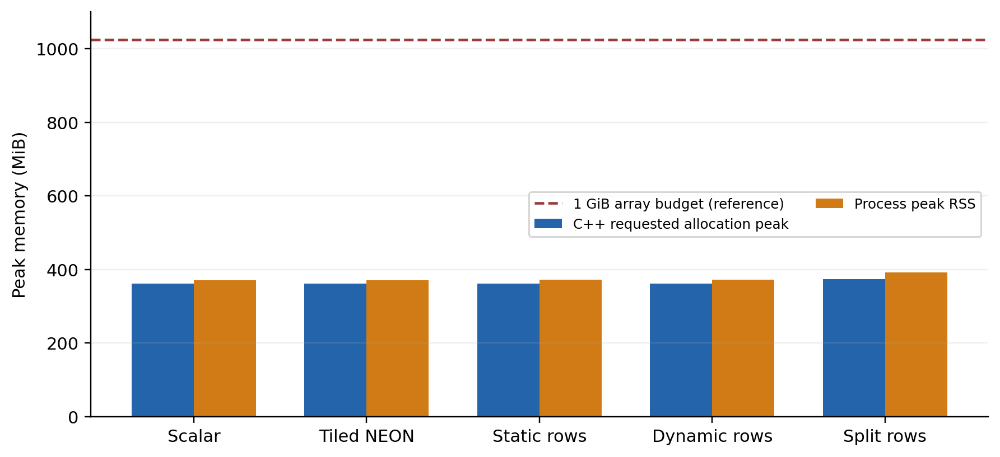
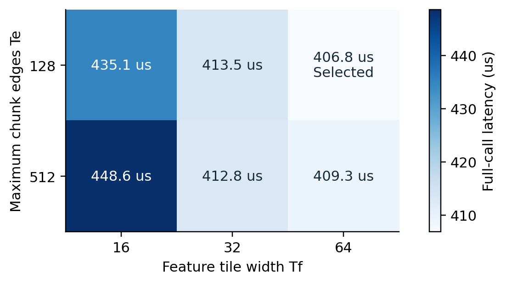
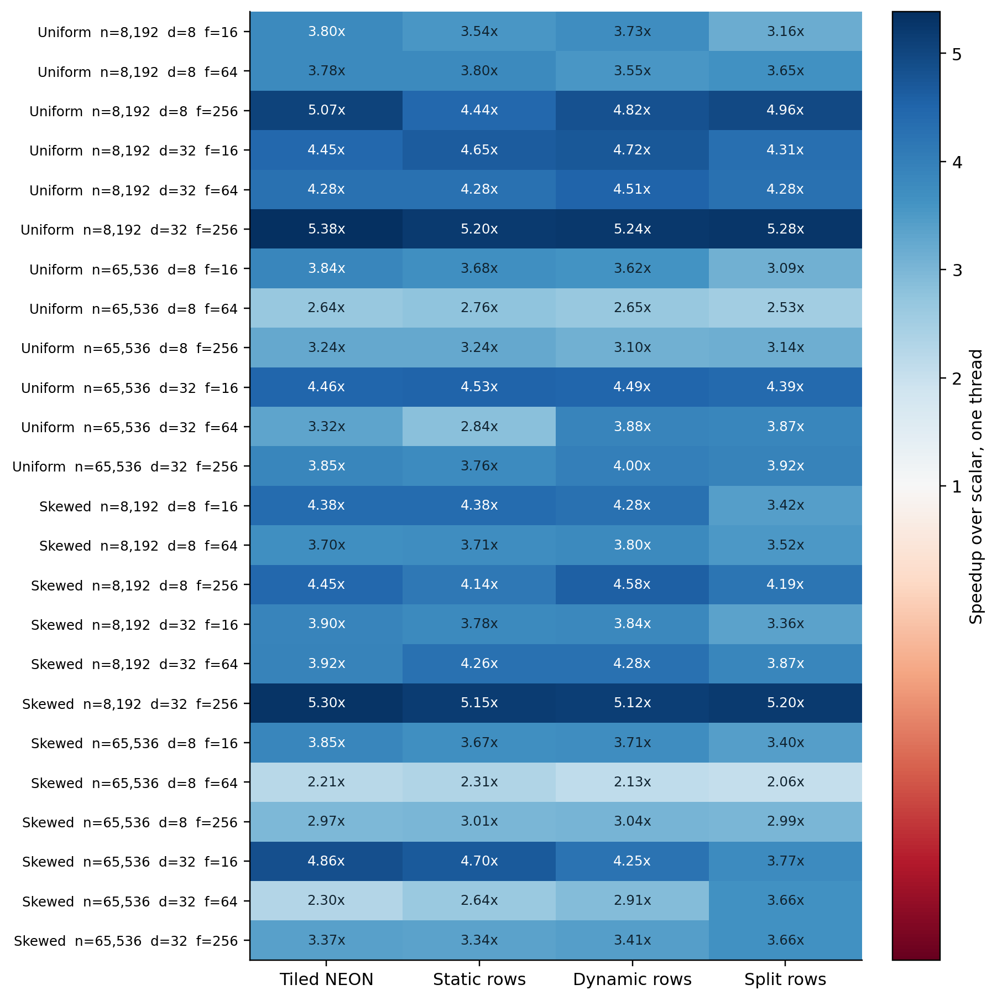
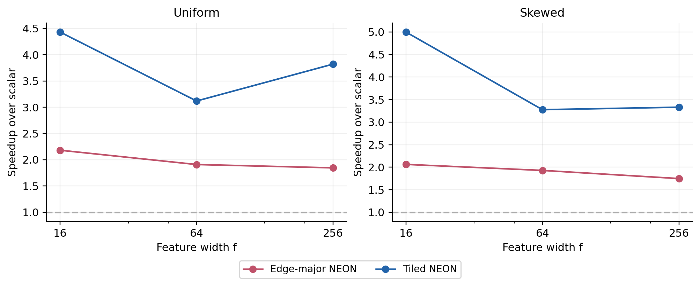
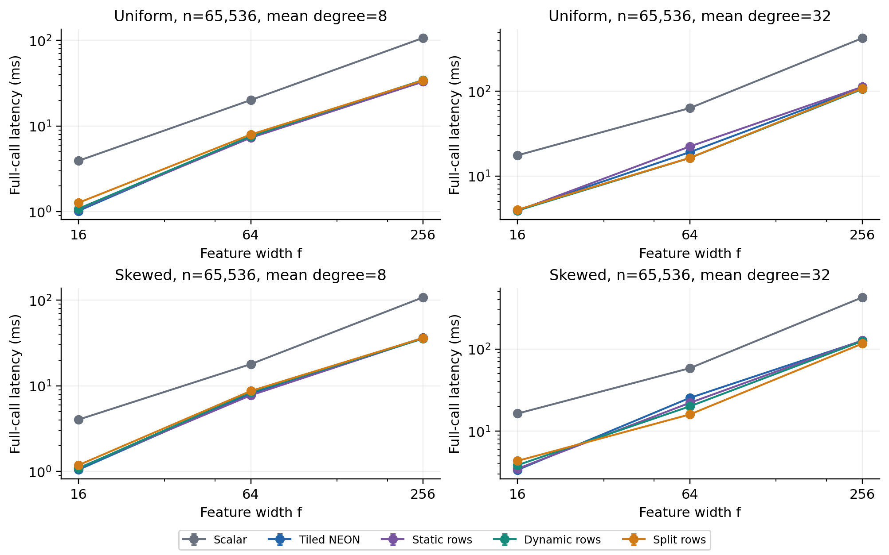
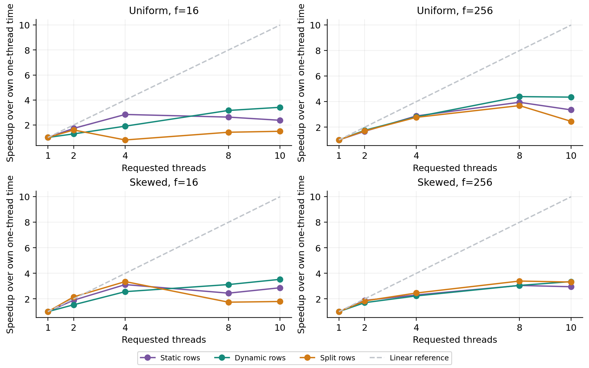
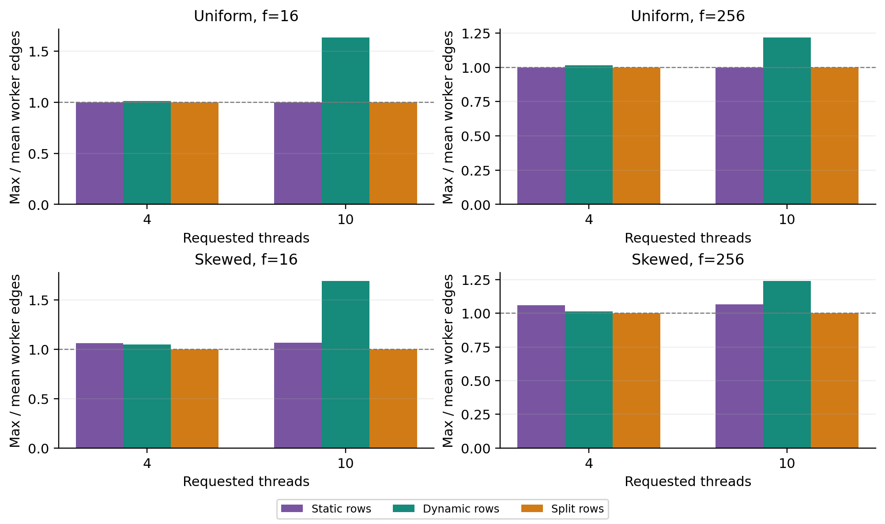
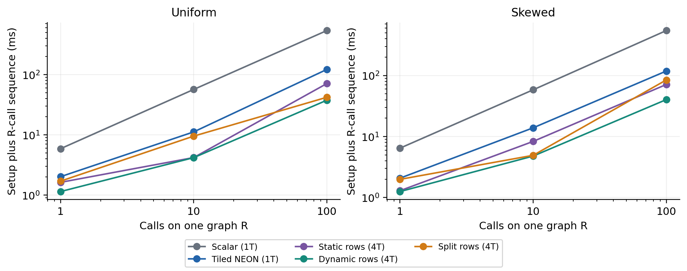

# Sparse Feature Aggregation on Apple M4

CEG5206 Group 5 Experimental Report

Native CPU measurements on 10 November 2026

We evaluate the weighted sparse matrix dense matrix product Y = AX used for mean neighborhood aggregation. We integrate the scalar CSR reference, tiled AArch64 NEON kernel, static and dynamic whole-row schedules, and edge-balanced split-row reduction. The study uses controlled graph families, identical stored FP32 inputs, an independent FP64 oracle, and complete-call timings on an Apple M4 CPU.

Across the 24 single-thread workloads, tiled NEON achieves a geometric-mean 3.79x speedup over scalar, ranging from 2.21x to 5.38x. A separate tuning set selects Tf=64 and Te=128. Split-row wins against the better whole-row schedule in 6 of the 20 scaling comparisons; its benefit depends on scheduling and partial-result costs.

| Evidence | Result |
| --- | --- |
| Native campaign | 392 cases and 5,880 recorded timing batches |
| Numerical validation | 784 stored reports; 0 failed outputs |
| Largest scaled error | 0.007880 of the tolerance allowance |
| Largest requested C++ allocation peak | 372.97 MiB |
| Largest process peak RSS | 392.53 MiB |

The measurements support the implemented CPU aggregation operator only. They do not measure GNN training, model accuracy, GPU execution, or performance on other processors. Performance conclusions use native M4 runs; prior emulated ARM checks are not used as speed evidence.

## Problem and implementation

For output node i and feature r, Y[i,r] is the sum over stored CSR edges e of values[e] times X[col_idx[e],r]. For mean aggregation, each nonempty row stores the FP32 value 1/degree(i). Empty rows produce zero. Self-loops contribute only when explicitly stored. The formal generated graphs exclude self-loops and duplicate neighbors.

CSR uses 64-bit row offsets, 32-bit column IDs, and FP32 values. X and Y are contiguous row-major FP32 arrays. Production multiplication and accumulation use FP32. The independent oracle starts from the original edge list captured before CSR construction and promotes stored FP32 operands to FP64 before multiplication and accumulation.

| Variant | Execution |
| --- | --- |
| Scalar | Single thread; row then edge then feature loops; automatic vectorization disabled only in scalar.cpp. |
| Tiled NEON | Vectorize four contiguous FP32 features at a time; keep a Tf=64 feature tile live while traversing neighbors; handle tails safely. |
| Static rows | Assign whole rows with OpenMP schedule(static); each row owns its output. |
| Dynamic rows | Assign whole rows with OpenMP schedule(dynamic,1); a dominant row remains indivisible. |
| Split rows | Build ceil(degree/Te) chunks and exclusive offsets with Te=128; assign chunks by edge counts; split chunks write private partials, then one owner merges each row in descriptor order. |

C constructs a deterministic longest-processing-time greedy assignment: sort chunks by descending edge count and assign each to the least-loaded worker bin, breaking ties deterministically. Its preparation is serial; it is not claimed to be a parallel scan implementation. Unsplit rows write directly to Y. Split-row execution has separate initialization, aggregation, and merge parallel regions.

Course connections include locality and feature tiling from L02 and L03, exclusive offsets from L04, and CSR storage, SIMD, reductions, and graph load balance from L06. The experiment connects these concepts through measured tradeoffs rather than assuming every transformation improves runtime.

## Hardware and experimental method

| Item | Recorded setting |
| --- | --- |
| Processor | Apple M4; 4 performance cores plus 6 efficiency cores; 10 physical/logical cores |
| Memory and OS | 24 GiB unified memory; macOS 15.7.7 |
| Caches | P cores: 192 KiB L1I, 128 KiB L1D, 16 MiB shared L2; E cores: 128 KiB L1I, 64 KiB L1D, 4 MiB shared L2 |
| Compiler | Apple Clang 17.0.0; C++17; CMake 4.4.3; libomp 23.1.1 |
| Numerical flags | -O3 -DNDEBUG -fno-fast-math -ffp-contract=off; scalar adds -fno-vectorize -fno-slp-vectorize |
| Thread policy | OMP_DYNAMIC=FALSE; OMP_PROC_BIND=FALSE; OMP_WAIT_POLICY=ACTIVE; KMP_BLOCKTIME=200 |
| Frequency and affinity | OS controlled, no frequency lock or hard P/E core pinning; low power mode disabled |
| Power evidence | Per-case sources: {'AC': 392}; battery percentage range [77, 85]. |

The formal grid crosses n in {8192,65536}, mean degree in {8,32}, f in {16,64,256}, and uniform/skewed graphs: 24 workloads. Skewed graphs assign half the edges to ceil(0.01n) randomly selected rows and half to the remaining rows. The model is controlled degree skew, not a claimed power law. Random seeds and actual degree statistics are saved.

Each case is a separate process. Arrays are allocated before timed aggregation. Both X arrays are validated twice in alternating order, with NaN-prefilled Y. Preparation is timed 10 times, destroying the previous state before each trial; its median is reported. After at least five warmups, calibration selects a power-of-two number of call groups targeting 20 ms per batch, capped at 1024 groups. Fifteen recorded batches follow. Very small smoke fixtures may reach the cap before the target.

Each batch times complete calls, including necessary clearing, scheduling, synchronization, and merging. X alternates continuously within the batch. The final Y is scanned after timing to make outputs observable. Reported per-call latency divides batch time by actual call count. Median and IQR describe the 15 batch averages, not 15 isolated cold calls. Case order is randomized with a saved seed. No allocations, file I/O, or oracle calls are included in the aggregation interval.

One X spans 0.5 MiB at n=8192 and f=16, and 64 MiB at n=65536 and f=256. Alternating two large X arrays exceeds the reported L2 capacities, so warm starts do not imply whole-input cache residency. This footprint comparison does not measure actual DRAM traffic.

## Correctness and memory evidence

Native production A+B+C passes all seven A correctness suites, including empty graphs, isolated nodes, signed weights, explicit self-loops, feature tails, chunk boundaries, repeated-state reuse, and high-degree hubs. The same seven suites pass AddressSanitizer and UndefinedBehaviorSanitizer. C passes its two native tests with the real B kernel. B passes optimized, sanitizer, assembly, concurrency, and D handoff checks. D passes ten Python tests and two CTest tests for measurement and allocation accounting.

Across the campaign, the 784 stored validation records total 3,303,636,992 output-element comparisons and report zero failures; this total includes repeated workloads across phases. The largest absolute error is 1.527e-07; the largest scaled error is 0.007880, below the acceptance boundary of 1. The elementwise criterion is abs(actual-reference) <= 1e-5 + 1e-4*abs(reference). Input byte digests agree across implementations for all 32 matching input groups.

The operator-new tracker records a high-water mark of requested C++ allocation sizes across generation, preparation, validation, and measurement. It includes container capacity and temporary allocations but excludes malloc/mmap allocations made internally by the runtime. Process peak RSS is independently recorded with getrusage. Retained graph, two X arrays, Y, descriptor, partial, and other-workspace bytes are also reported separately. All observed C++ peaks remain within the 1 GiB array budget; no grid reduction was needed.

ASan/UBSan do not prove race freedom. Native tests exercise concurrent ownership; A also supplied a separate x86 ThreadSanitizer plus Archer review of the production C adapter. This report does not claim a new native M4 ThreadSanitizer result. Production C changes in this branch are compile-guarded diagnostic hooks; normal execution retains the original ownership and synchronization.

## Parameter selection

Tuning uses separate-seed uniform and skewed graphs with n=16384, mean degree=16, f=64 and four threads. We evaluate Tf in {16,32,64} and Te in {128,512}. The selection score is the geometric mean of the two full-call medians. The selected pair is frozen before the main, scaling, reuse, ablation, and diagnostic phases; test results are not used to choose parameters.

| Tf | Te | Uniform us | Skewed us | Geometric mean us |
| --- | --- | --- | --- | --- |
| 64 | 128 | 410.3 | 403.4 | 406.8 |
| 64 | 512 | 406.2 | 412.4 | 409.3 |
| 32 | 512 | 409.6 | 415.9 | 412.8 |
| 32 | 128 | 412.4 | 414.7 | 413.5 |
| 16 | 128 | 434.0 | 436.2 | 435.1 |
| 16 | 512 | 431.4 | 466.5 | 448.6 |

The selected pair is Tf=64, Te=128. The frozen configuration and tuning-manifest SHA-256 are retained. A single selected pair keeps optimized schedules comparable; it does not establish a globally optimal choice for every graph, feature width, processor, or thread count. Small score differences should be interpreted alongside within-run variation.

## Single thread results across all workloads

Tiled NEON has a geometric-mean 3.79x scalar speedup. Static, dynamic, and split-row routes at one thread achieve geometric means of 3.75x, 3.82x, and 3.66x. These routes share the SIMD kernel; these gains should not be attributed to parallelism.

## SIMD and feature tiling attribution

To distinguish vector arithmetic from tiling, we additionally integrate B's edge-major NEON control into the same D runner. It updates Y for each edge without feature tiling, while the tiled kernel holds an output tile live. All controls use actual A-generated inputs, the same FP64 validation, numerical flags, and timing protocol; B's earlier M5 probe data are not mixed into this campaign.

Across all 24 ablation workloads, tiled NEON is 1.79x faster than edge-major NEON in geometric mean, with ratios from 1.30x to 2.42x. A ratio below 1 means tiling is slower for that workload. Holding an output tile live can reduce output load/store activity, but f larger than Tf repeats CSR metadata traversal. Allocated bytes alone do not measure either cache misses or DRAM traffic.

## Thread scaling on heterogeneous cores

| Family | f | Fastest parallel route | Threads | Latency ms | Scalar speedup |
| --- | --- | --- | --- | --- | --- |
| Uniform | 16 | Dynamic rows | 10 | 1.060 | 14.97x |
| Uniform | 256 | Dynamic rows | 8 | 24.793 | 16.95x |
| Skewed | 16 | Dynamic rows | 10 | 1.006 | 15.20x |
| Skewed | 256 | Split rows | 8 | 34.221 | 12.19x |

Split-row is faster than the better whole-row route in 6/20 matched scaling comparisons; the whole-row-to-split ratios range from 0.26x to 1.17x. The comparison holds graph, inputs, f, threads, and numerical policy fixed. These are descriptive median comparisons, not significance tests. No single schedule is assumed to win universally.

Four requested threads do not guarantee execution on exactly four performance cores. At eight and ten threads, the OS may use a different mix of performance and efficiency cores. Thread migration, bandwidth contention, and active-wait synchronization can limit scaling. The measurements cannot isolate those causes without additional affinity and hardware-counter evidence.

## Worker distribution and degree skew

Static scheduling assigns contiguous row ranges, so degree variation can cause unequal edge counts. Dynamic scheduling redistributes entire rows; faster workers may intentionally process more edges. C's split route assigns chunks to logical worker bins according to edge counts, then executes every bin even when the runtime supplies fewer physical workers.

The imbalance metric measures edge distribution, not elapsed-time balance. On a heterogeneous CPU, equal edges per worker may still yield unequal completion times, while unequal dynamic edge counts can be appropriate. It is therefore insufficient to explain performance solely from a lower maximum-to-mean edge ratio. Feature access locality, scheduling overhead, synchronization, and merge work also matter.

| Family | n | Mean degree | Median | p99 | Maximum |
| --- | --- | --- | --- | --- | --- |
| Skewed | 65,536 | 32 | 16 | 1598 | 1599 |
| Skewed | 65,536 | 8 | 4 | 399 | 400 |
| Skewed | 8,192 | 32 | 16 | 1598 | 1599 |
| Skewed | 8,192 | 8 | 4 | 399 | 400 |
| Uniform | 65,536 | 32 | 32 | 32 | 32 |
| Uniform | 65,536 | 8 | 8 | 8 | 8 |
| Uniform | 8,192 | 32 | 32 | 32 | 32 |
| Uniform | 8,192 | 8 | 8 | 8 | 8 |

## Aggregation and merge diagnostics

The diagnostic target is built separately with CEG5206_D_DIAGNOSTICS. The production target contains no diagnostic phase timers or worker-edge increments. Each phase timer includes the associated OpenMP region and its end synchronization. Worker counting can perturb cache and scheduling behavior, so phase values explain structure and overhead but are not substituted into the primary speedup results.

The uniform degree-32 cases have no split rows when Te exceeds 32. They still pay descriptor construction, worker-bin traversal, and phase-launch overhead in the split route, even when partial storage is zero. Skewed cases create private partials for the high-degree rows. Their logical partial size is 4*f*C_s bytes, where C_s counts chunks belonging to split rows only.

| Family | f | Prepare median ms | Descriptors MiB | Partials MiB |
| --- | --- | --- | --- | --- |
| Uniform | 16 | 2.101 | 3.000 | 0.000 |
| Uniform | 256 | 1.754 | 3.000 | 0.000 |
| Skewed | 16 | 2.626 | 3.300 | 0.521 |
| Skewed | 256 | 2.690 | 3.300 | 8.328 |

Preparation includes the scan/descriptor layout, sorting, greedy assignment, and partial allocation. The median of ten preparations is reported; graph sampling is separate. The complete per-call measurement includes all initialization and merge costs. The three split phases use separate parallel regions, so better edge balance must compensate for additional execution overhead.

## Graph reuse and setup amortization

For R in {1,10,100}, each measured group contains exactly R full calls alternating X0/X1. A batch can contain several such groups to reach timer resolution; dividing batch time by the number of groups yields the R-call sequence estimate. State is prepared once and reused throughout. We report T(R)=shared setup+median variant preparation+median sequence time. This is a warm-start amortization study, not R independent cold processes.

| Family | Variant | Threads | Per call ms | Total at R 100 ms |
| --- | --- | --- | --- | --- |
| Uniform | Scalar | 1 | 5.393 | 540.15 |
| Uniform | Tiled NEON | 1 | 1.215 | 122.24 |
| Uniform | Static rows | 4 | 0.706 | 71.22 |
| Uniform | Dynamic rows | 4 | 0.370 | 37.68 |
| Uniform | Split rows | 4 | 0.414 | 42.16 |
| Skewed | Scalar | 1 | 5.451 | 546.20 |
| Skewed | Tiled NEON | 1 | 1.179 | 118.58 |
| Skewed | Static rows | 4 | 0.707 | 71.44 |
| Skewed | Dynamic rows | 4 | 0.397 | 40.36 |
| Skewed | Split rows | 4 | 0.835 | 84.73 |

Shared setup comprises stored-weight preparation and CSR construction; sampling and feature generation are excluded from T(R), matching the interface convention. Sampling is still recorded separately. Shared setup is one observation per case while variant preparation uses a ten-trial median; small setup differences between independently run variants are measurement noise, not algorithmic differences. Reuse amortizes preparation but does not remove split-row per-call synchronization or merging.

## Conclusions reproducibility and contributions

On this M4 campaign, tiled NEON is consistently faster than scalar on the tested grid, with geometric-mean speedup 3.79x. Splitting improves edge-count balance but beats the better whole-row route in 6/20 tested scaling comparisons. The appropriate schedule depends on feature width, degree structure, thread count, and the cost of repeated parallel regions and partial reduction. The project demonstrates tradeoffs rather than a predetermined speedup.

Limits: one processor and one campaign; synthetic controlled graphs; one common tuned pair; no hard affinity or frequency control; heterogeneous cores; warm-start batches with two feature arrays; no native M4 race-detector result; no cache-miss or DRAM-bandwidth counters; and no full GNN or accuracy evaluation. Within-run IQR does not quantify cross-day or cross-machine uncertainty. Power source and charge are retained per case, and any transition is visible in the evidence.

Reproduction starts from this integrated branch. Run bash member_d/scripts/build_team.sh, then bash member_d/scripts/run_campaign.sh with a fresh output directory. The campaign executes tuning before freezing configurations. Run analyze.py and write_report.py with the campaign, figures, and report paths. See member_d/README.md for complete commands and dependencies. Each phase retains configuration, ordered cases, source commit/patch, binary SHA-256, environment, raw calls, validation, setup, memory, and degree records. evidence_sha256.json indexes the evidence files.

| Member | Contribution represented in this report |
| --- | --- |
| A | CSR validation/build, deterministic input generation, scalar baseline, independent FP64 oracle, chunk audit, correctness suites. |
| B | Tiled NEON and row-range primitives, tail handling, edge-major ablation control, SIMD tests and assembly checks. |
| C | Static/dynamic whole-row scheduling, scan-based chunks, edge-count assignment, private partials and deterministic reduction. |
| D | Native integration, batching/reuse measurement, parameter freeze, allocation tracking, separate diagnostic hooks, campaign execution, input/evidence audits, English figures and report. |

References: [1] Group 5 Team Project Proposal, computation contract and experimental design. [2] CEG5206 lecture topics cited by the proposal: locality/tiling, scan, CSR, SIMD, reduction and graph balance. [3] A implementation 43842aa, B implementation 2c8f04f, C implementation 8a06e1b, and D integration commits recorded in each manifest. [4] Native evidence and validation logs under member_d/evidence/apple-m4. A's prior QEMU/TSan records are supporting validation only, not native performance data.
